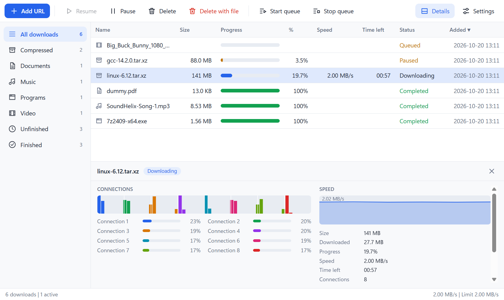
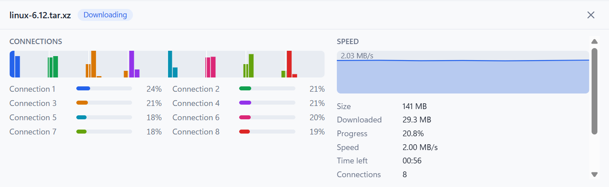
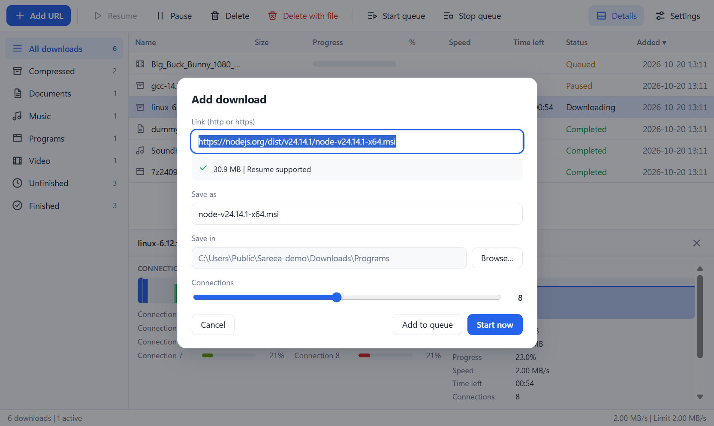
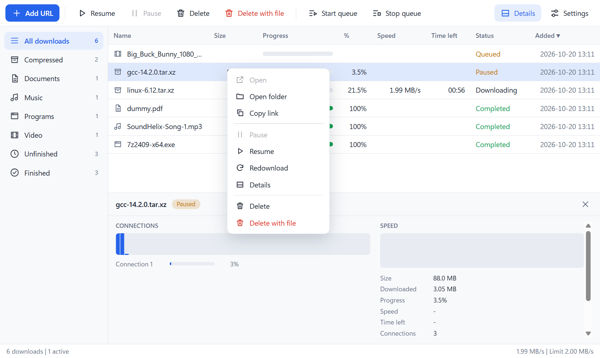
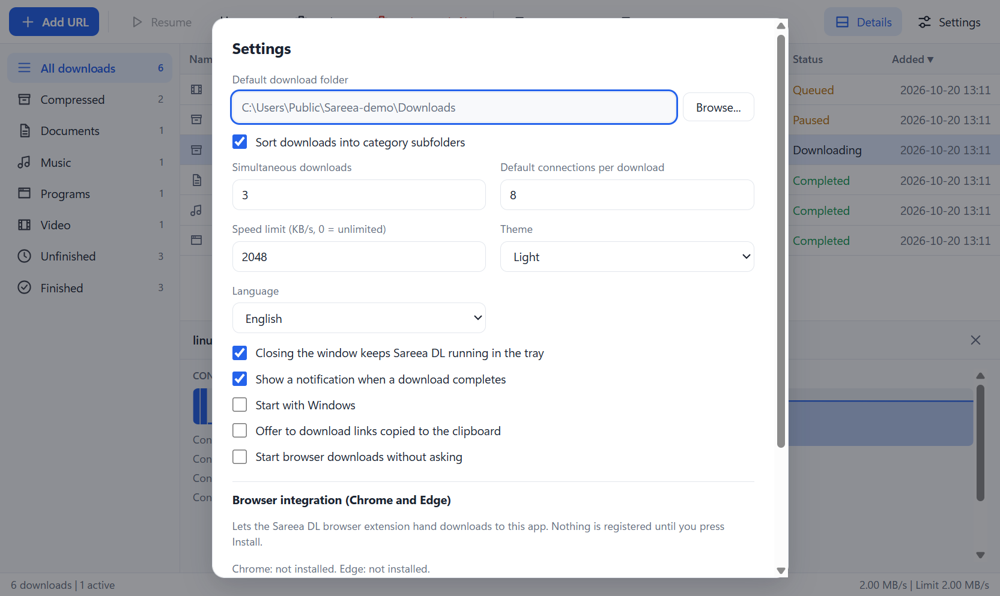
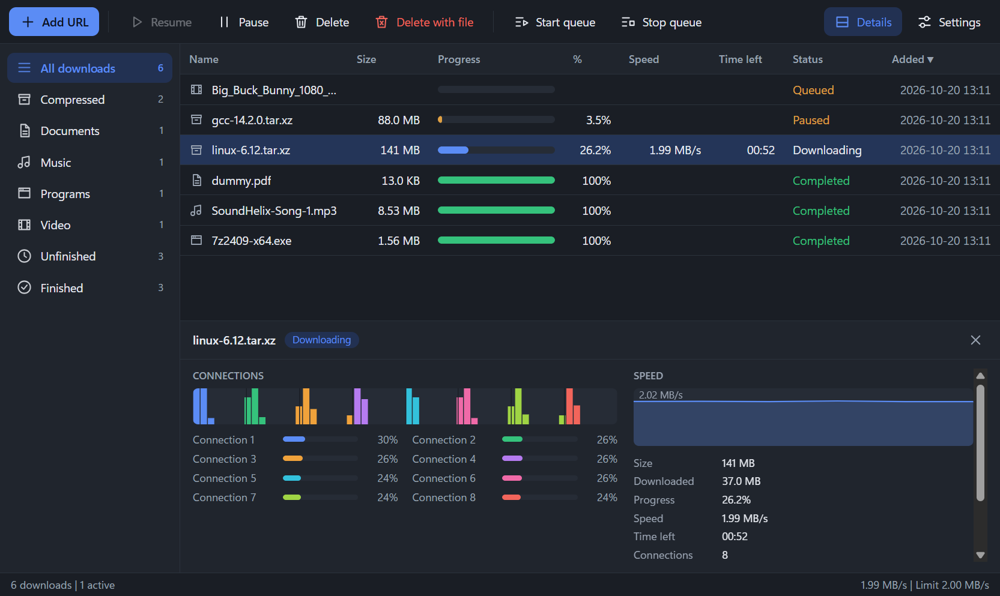
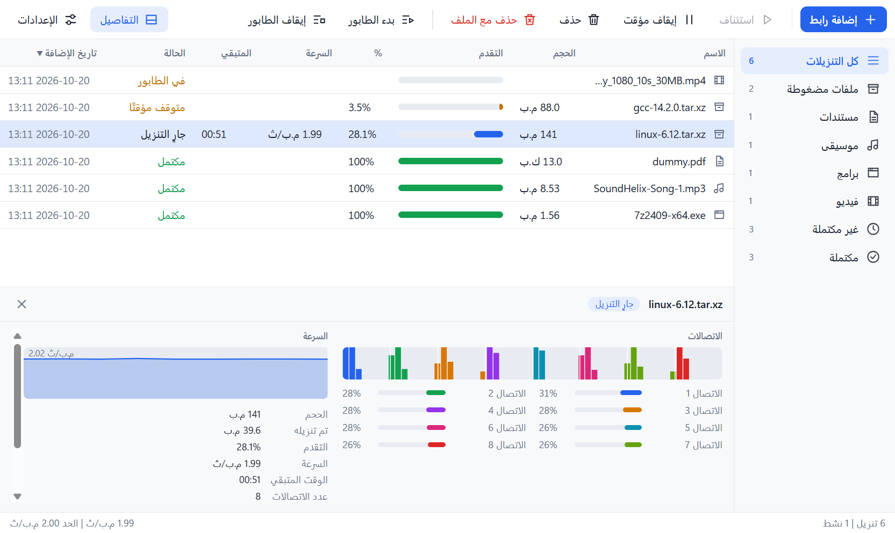
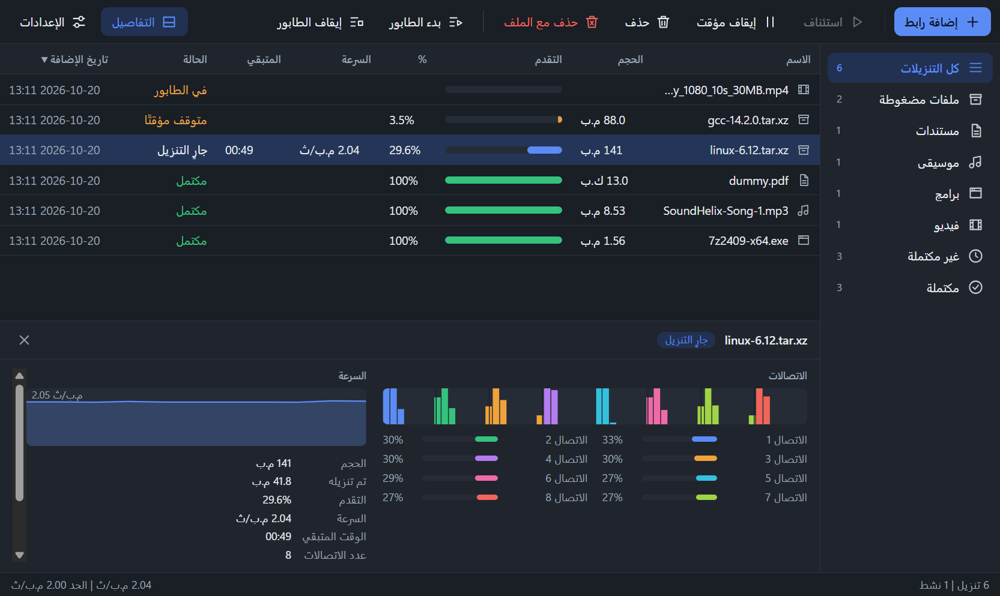
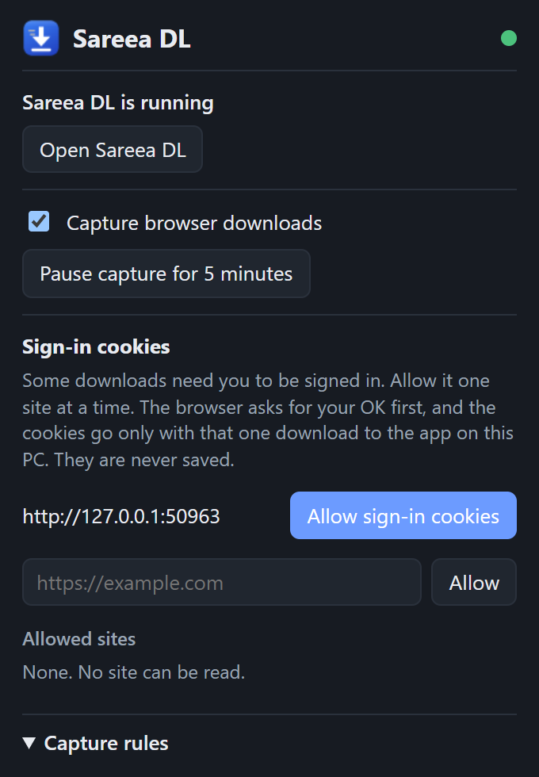
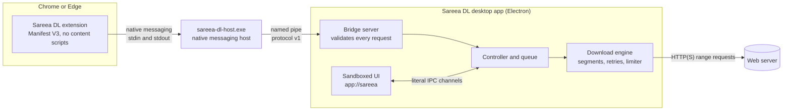

<div align="center">


# Sareea DL

**Fast, private, from-scratch download manager for Windows**

*Sareea* (سريع) means "fast" in Arabic.


<br>



</div>

## Why Sareea

Download managers like IDM are fast because they open several connections to the same file and keep every one of
them busy. They are also closed programs that ask for a lot of trust: they sit in your browser, see your traffic and
phone home.

Sareea DL keeps the speed and drops the trust problem.

* **Fast.** Up to 16 connections per file. When a connection finishes early it takes half of the biggest piece that is
  still left, so a slow connection never becomes the tail of the download.
* **Dependable.** Pause, close the app, reboot, resume. The saved state is checked against the server's ETag,
  Last-Modified and size before a single byte is reused.
* **Private.** No telemetry, no update pings, no account. The browser extension reads nothing until you grant one site.
* **Small enough to audit.** The download engine is plain TypeScript with no runtime dependency. The whole project was
  written from scratch, and the release build is checked for test hooks on every package.

## Features

| | |
|---|---|
| **Multi-connection downloads** | 1 to 16 connections per file, dynamic segmentation with work stealing, every `206` reply validated against its `Content-Range` |
| **Pause and resume** | Survives restarts. Resumes from the saved segments, or restarts cleanly when the ETag, date or size changed (`remote-changed`) |
| **Retries** | Exponential back-off (0.5 s up to 30 s), honours `Retry-After`, retries stalls, 5xx, 429 and 408 per segment |
| **Speed limiter** | One global limit in KB/s, changeable while downloads run |
| **Queue** | Up to 10 simultaneous downloads, "Add to queue", Start queue and Stop queue |
| **Categories** | Compressed, Documents, Music, Programs, Video, Unfinished, Finished, plus optional category sub-folders |
| **IDM-style detail panel** | A coloured block per slice of the file, a bar per connection, a live speed graph and transfer details |
| **Tray and notifications** | Closes to the tray, notifies when a download completes, quits cleanly and saves first |
| **Clipboard watch** | Optionally offers to download links to downloadable file types when you copy them |
| **English and Arabic** | Full right-to-left Arabic layout, light and dark theme |
| **Browser capture** | Chrome and Edge extension hands downloads to the app, with a Pause capture button and per-site cookie grants |
| **Safe by default** | Verifies SHA-256 on request, safe file names, Mark of the Web on finished files, confirmation before opening programs |

## Screenshots

<table>
  <tr>
    <td width="50%"><br><sub><b>Detail panel.</b> Each colour is one connection. Work stealing keeps all of them busy.</sub></td>
    <td width="50%"><br><sub><b>Add download.</b> The link is probed first: size, resume support, name, folder, connections.</sub></td>
  </tr>
  <tr>
    <td width="50%"><br><sub><b>Right-click menu.</b> Open, open folder, copy link, pause, resume, redownload, delete.</sub></td>
    <td width="50%"><br><sub><b>Settings.</b> Folder, queue size, connections, speed limit, theme, language, browser integration.</sub></td>
  </tr>
  <tr>
    <td width="50%"><br><sub><b>Dark theme.</b> System, light or dark.</sub></td>
    <td width="50%"><br><sub><b>Arabic, right to left.</b> The whole layout mirrors, not just the text.</sub></td>
  </tr>
  <tr>
    <td width="50%"><br><sub><b>Arabic, dark.</b></sub></td>
    <td width="50%"><br><sub><b>Browser extension popup.</b> Status, pause capture, per-site cookie permission, capture rules.</sub></td>
  </tr>
</table>

<sub>The screenshots show real downloads of public files (small installers, a song, a PDF and source tarballs) taken from the
test build of the app. See [docs/development.md](docs/development.md#regenerating-the-readme-screenshots) to regenerate them.</sub>

## Privacy and security by design

Sareea DL is built on the assumption that a download manager should not need your trust.

* **No telemetry.** No analytics, no crash reporting, no update checks. The only network traffic is the downloads you
  start (and the link probe in the Add dialog for a link you typed).
* **A browser extension that sees nothing by default.** No content scripts, no static host permissions, no `tabs`,
  `activeTab`, `webRequest` or `scripting`. Site access is requested **one origin at a time**, only inside a click, and can be
  revoked from the popup.
* **Cookies only for sites you grant, and never stored.** They are read for the exact download URL, sent to the app for
  that one download, kept in memory for 10 minutes under a single-use token, and never written to disk or logs.
* **Hardened Electron.** `contextIsolation`, `sandbox`, no Node in the page, a strict CSP, the UI served from a custom
  `app://` scheme (not `file://`), literal IPC channel names with a sender check and a validator on every handler, and
  Electron fuses flipped in the packaged exe.
* **Release build stripped of test hooks.** The self-test and the test-only environment variables are compiled out of
  the release flavour, and `npm run package` fails if any hook string is found in the app or the native host.
* **Audited with a reverse-engineering toolkit.** The build was checked statically with the
  [REA](https://github.com/morluto/rea) (Reverse Engineer Anything) toolkit, run on a copy of the packaged app and the extension.

| What was checked | Result |
|---|---|
| Electron fuses | `RunAsNode` off, `NODE_OPTIONS` ignored, inspect arguments off, cookie encryption on, ASAR integrity on, load only from `app.asar`, file-protocol privileges off |
| Window settings | `nodeIntegration` off, `contextIsolation` and `sandbox` on, `webSecurity` on, no webviews, DevTools off when packaged |
| IPC | Every channel is a string literal at its call site; each handler checks the sender first, then its own validator (found dynamic names in the first audit, fixed, and covered by a test) |
| Test hooks in the release | Found in the first audit, fixed by two build flavours and a release gate that scans the asar and the host exe as UTF-8 and UTF-16 |
| Browser extension | Exact permission list, no content scripts, strict extension CSP, no `eval`, no network request of its own |
| Native host | 34 KB C# program, checks its caller's origin, logs nothing, writes nothing to disk, reads no environment variable in the release build |
| Local pipe | Restricted to your user, Administrators and SYSTEM; validated, size-limited requests; a browser request only opens a prefilled dialog unless you turn "start without asking" on |

Static analysis cannot prove runtime behaviour, and the build is not code-signed. Full details, the permission table and the
limits are in [docs/security.md](docs/security.md) and [docs/extension.md](docs/extension.md).

## Architecture



The host is a small .NET Framework program, not a mode of the Electron exe: Electron writes a stray CR LF to stdout at
start-up, which breaks the browser's length-prefixed framing. The reasoning, measurements and the pipe protocol are in
[docs/extension.md](docs/extension.md) and [docs/protocol.md](docs/protocol.md). The source layout and how one download
runs, step by step (probe, resume check, segments, validation, retry, finish) are in [docs/architecture.md](docs/architecture.md).

## Install and build from source

**Easiest:** download the installer or the portable zip from [Releases](https://github.com/Nanoxlr8/sareea-dl/releases/latest). The build is not code-signed yet, so Windows SmartScreen may warn on first run (More info → Run anyway).

To build it yourself instead: You need Windows 10 or 11 (x64),
Node 24 or newer with npm, and Git. The native host is compiled with `csc.exe`, which ships with the .NET Framework 4 on every
Windows 10 and 11 PC.

```
git clone https://github.com/Nanoxlr8/sareea-dl.git
cd sareea-dl
npm install
node node_modules/electron/install.js    # only if node_modules/electron/dist is missing (npm 11 can skip the download)
npm run package                          # release build, gate included
```

The app is then in `out\Sareea DL-win32-x64\Sareea DL.exe` (with `sareea-dl-host.exe` next to it), and the extension is in
`out\extension` (also as `out\sareea-dl-extension.zip`). To try it without packaging, `npm start` builds the test flavour and opens it.

### Load the browser extension

1. Start Sareea DL, open **Settings** and press **Install browser integration** (off by default, nothing registers itself;
   it writes two HKCU registry values and one manifest, no admin rights).
2. Open `chrome://extensions` (or `edge://extensions`), turn on **Developer mode**, choose **Load unpacked** and select
   `out/extension`. The **Open extension folder** button in Settings opens it for you.
3. Download something. A matching file goes to Sareea DL; if the app is not running the browser starts it.
4. To allow sign-in cookies for a site, use **Allow sign-in cookies** in the extension popup. To undo everything, press
   **Remove browser integration** and remove the extension.

### Command line

The engine also works on its own:

```
node src/cli.ts <url> [-o dir] [-c 8] [--limit 2M] [-n name] [-H "Name: value"] [--sha256 hex]
```

Ctrl+C pauses cleanly and running the same command again resumes. More in [docs/engine.md](docs/engine.md).

## Testing

```
npm test                  # 321 tests, about 10 seconds
npm start -- --self-test  # the real app proves an end-to-end download (27 checks, needs internet)
npm run package:test      # test flavour, then:
npm run e2e:extension     # real Chrome (E2E_BROWSER=edge for Edge), real app, real native host: 70 checks
```

* `npm test` covers the engine, the app logic, the IPC audit, the `app://` scheme, the pipe ACL command, the build flavours
  and the release gate, the bridge protocol, the extension logic and the native host (compiled and driven like a browser).
* The end-to-end run uses a throw-away browser profile and test data folder, registers the host under HKCU for the run only,
  removes the registry key afterwards, and kills only what it started.
* `npm run check:release` searches the release package for test hooks; it also runs at the end of `npm run package`.

Everything about building, running and testing: [docs/development.md](docs/development.md).

## Documentation

| | |
|---|---|
| [docs/desktop-app.md](docs/desktop-app.md) | Every part of the desktop app, persistence, the local bridge |
| [docs/extension.md](docs/extension.md) | Extension, permissions, cookies, native host, registration, tests, limits |
| [docs/protocol.md](docs/protocol.md) | The named-pipe protocol, version 1 |
| [docs/security.md](docs/security.md) | The full security model |
| [docs/engine.md](docs/engine.md) | Engine API, command line options, events |
| [docs/architecture.md](docs/architecture.md) | Source layout, how a download runs, design decisions and limits |
| [docs/development.md](docs/development.md) | Build, run, test, self-test, regenerating the screenshots |

## Roadmap

- [x] Installer and portable build
- [ ] Code signing
- [ ] Firefox support (different manifest and host registration)
- [ ] Proxy settings
- [ ] Scheduler
- [ ] Extension store listing and an Arabic popup
- [ ] Site grabber, video capture, auto-extraction, FTP

## About

Sareea DL is written from scratch in TypeScript. It is an independent project, not affiliated with or derived from
Internet Download Manager (IDM) or any other download manager.
